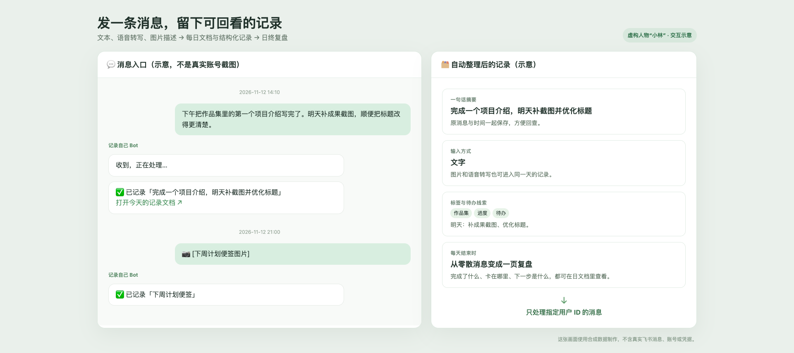
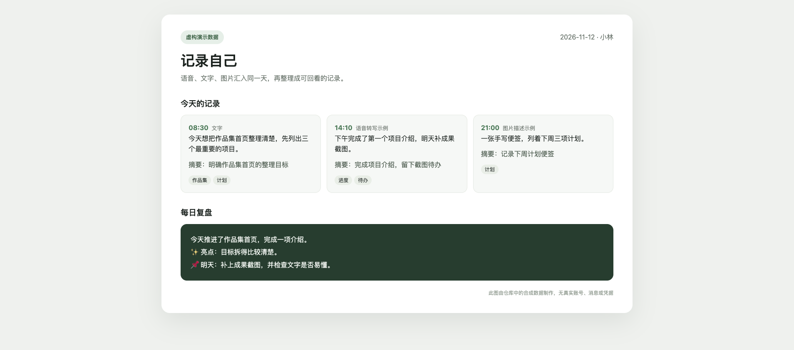

# Self Record Bot

**Language:** [简体中文](README.md) · English · [日本語](README.ja.md)

**Turn messages you send to yourself into a dated, searchable record.** Send text, voice, or an image to your own bot; it keeps the original message, a short summary, and a link to the daily document. Daily review brings the fragments back together.

### What it looks like · fictional person and data

**Message to structured record:**

**Daily review:**

Only the configured owner ID is processed. The screenshots are illustrative mockups, not a capture of anyone's Feishu account.

A single-person Feishu bot for collecting text, voice transcripts, and images into personal records, then creating daily summaries and follow-up tasks. The bundled “Xiaolin” records are fictional and illustrate the data shape without an actual Feishu account.

## Setup

Use Node.js 20+. Run `npm ci`, copy `.env.example` to `.env`, and fill in your own `FEISHU_APP_ID`, `FEISHU_APP_SECRET`, and `FEISHU_OWNER_ID`. Folder tokens and an OpenRouter API key are optional according to the features you enable. Run `npm test`, then `npm start`. Only messages from the configured owner ID are processed. Follow the [Chinese guide](README.md) for Feishu application scopes, table creation, and the available commands.

Do not commit `.env`, runtime table IDs, reminders, or personal records. This public edition removes the chat-triggered local command path. AI and Feishu behavior require your own credentials and have not been tested against your account.

MIT License.

Set `BOT_LANGUAGE=zh`, `en`, or `ja` to choose the reply and AI output language.
