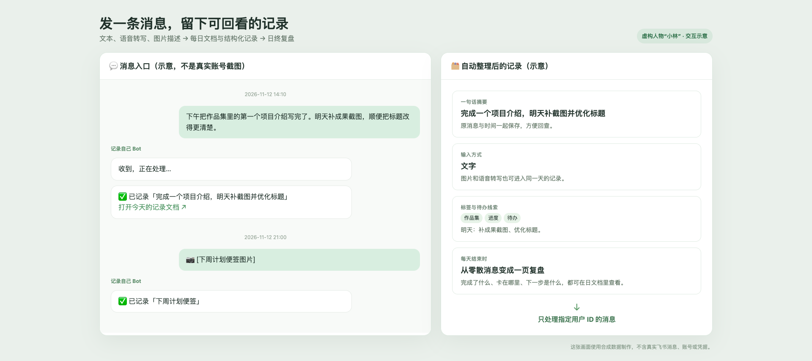
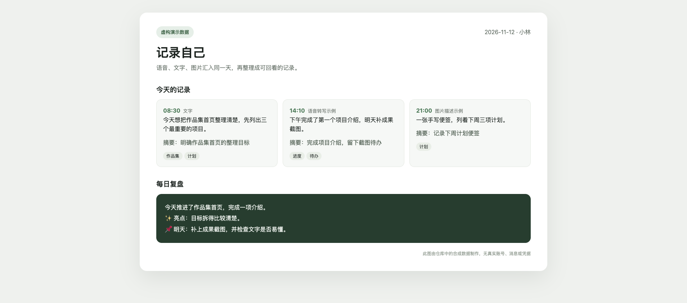

# 自分を記録する Bot

**言語:** [简体中文](README.md) · [English](README.en.md) · 日本語

**自分に送る短いメッセージを、日付付きで探せる記録に変えます。** テキスト、音声、画像を自分の Bot に送ると、元の内容、短い要約、当日の文書へのリンクを残します。日次の振り返りで断片をまとめて見直せます。

> **企業向け AI 化のコンサルティングと開発**（Feishu/Lark 連携、プライベート導入、カスタム開発）→ [buildwithneo.cn](https://buildwithneo.cn/)

### 画面の例 · 人物とデータはすべて架空

**メッセージから構造化記録へ:**

**一日の振り返り:**

設定した所有者 ID からのメッセージだけを処理します。画像は実際の Feishu アカウントのスクリーンショットではなく、説明用のモックです。

テキスト、音声の文字起こし、画像を個人記録にまとめ、日次の振り返りとタスクを作る一人用 Feishu Bot です。同梱の「小林」の記録はすべて架空で、実際の Feishu アカウントを含みません。

## セットアップ

Node.js 20 以上を使用します。`npm ci` を実行し、`.env.example` を `.env` にコピーして、自分の `FEISHU_APP_ID`、`FEISHU_APP_SECRET`、`FEISHU_OWNER_ID` を設定してください。フォルダートークンと OpenRouter API キーは有効にする機能に応じて設定します。`npm test` の後、`npm start` で起動します。設定した所有者 ID からのメッセージだけを処理します。Feishu アプリの権限、テーブル作成、コマンドの詳細は[中国語ガイド](README.md)を参照してください。

`.env`、実行時のテーブル ID、リマインダー、個人記録を Git に入れないでください。公開版ではチャットからローカルコマンドを実行する経路を削除しました。AI と Feishu の実動作には各自の認証情報が必要です。

MIT License。

返信と AI 出力の言語は `BOT_LANGUAGE=zh`、`en`、`ja` から選べます。
