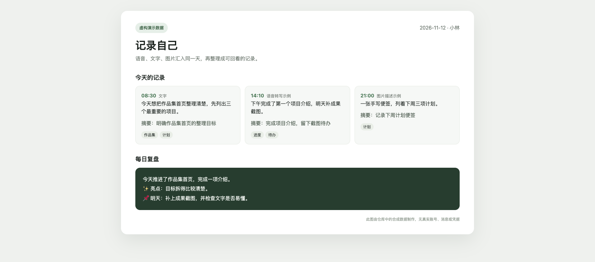

**语言 / Language / 言語:** [简体中文](README.md) · [English](README.en.md) · [日本語](README.ja.md)

# 记录自己 · 飞书机器人

通过飞书机器人发**语音 / 文字 / 图片** → 自动归档到**当日云文档** + 写入**多维表格** → AI 整理（模型可配置）。本机部署，飞书长连接，无需公网域名。

## 一、功能概览

- 收到消息：语音转文字（飞书 STT）、图片用 Sonnet 理解、文字直接入库
- 每条记录：DeepSeek 生成一句话摘要 + 标签 + 情绪；**仅在明显提问/情绪低落时即时回复**（AI 判断），回复来源标注 DeepSeek
- 当日云文档：按天一篇，所有原文按时间追加
- 多维表格 4 张表：原始记录 / 每日复盘 / 周月复盘 / 目标项目
- 定时整理（Sonnet 4.6）：每天 23:00（23 点后的消息次日 02:00 补整理）、每周日 22:00、每月 1 日 03:00

## 二、环境准备

1. **Node.js ≥ 18**（推荐 20/22）
2. **ffmpeg**（语音识别需要，把 opus 转成 16k pcm）
   - Windows：下载 ffmpeg，把 `ffmpeg.exe` 所在目录加入 PATH，或在 `.env` 里写 `FFMPEG_PATH=完整路径\ffmpeg.exe`
3. **OpenRouter API Key**（自行申请）

## 三、飞书开放平台配置

到 https://open.feishu.cn 创建**企业自建应用**，然后：

### 1. 开通机器人能力
「应用功能 → 机器人」打开开关。

### 2. 申请权限（权限管理）
- `im:message`、`im:message:send_as_bot`（收发消息）
- `im:resource`（下载语音/图片）
- `speech_to_text:speech`（语音识别）
- `bitable:app`（多维表格读写）
- `docx:document`、`drive:drive`（云文档创建/编辑）
- `calendar:calendar`、`calendar:calendar.event:create`（提醒功能同步创建日历事件）
- `task:task:write` 或 `task:task:writeonly`（创建飞书任务）

### 3. 事件订阅（用长连接，免公网）
「事件与回调 → 事件配置」选择**长连接**方式，订阅事件：
`接收消息 v2.0`（`im.message.receive_v1`）。

### 4. 文件夹授权（重要）
多维表格和云文档要建在你的两个文件夹里。请把这两个文件夹**共享给该应用/机器人「可编辑」权限**（或把机器人加入对应 Wiki/空间），否则建表与建文档会因无权限失败。

### 5. 发布版本
权限改动后，到「版本管理与发布」创建版本并发布，等待生效。

## 四、安装与配置

```bash
cd self-record-bot
npm install
cp .env.example .env      # Windows: copy .env.example .env
# 编辑 .env，填写 APP_ID / APP_SECRET / FEISHU_OWNER_ID / OPENROUTER_API_KEY
# 填入你自己创建的两个文件夹 token；示例文件不含任何真实凭据
```

## 五、首次建表

```bash
npm run create-tables
```

成功后会在 `BITABLE_FOLDER_TOKEN` 文件夹里创建「记录自己」多维表格，并生成 `table-ids.json`（保存 app_token 与各表 id，**请勿删除**）。
> 新建的多维表格会自带一张默认空表「数据表」，可在网页里手动删除。

## 六、启动

```bash
npm start
```

看到「飞书长连接已建立」后，用 `FEISHU_OWNER_ID` 对应的飞书账号给机器人发消息。其他账号的消息会被忽略，不会写入记录或收到回复。

### 手动触发整理（测试用）
```bash
npm run summarize:day            # 整理今天
node scripts/run-job.js daily 2026-06-07
node scripts/run-job.js weekly   # 整理本周
node scripts/run-job.js monthly  # 整理本月
```

## 七、长期运行（开机自启）

任选其一：

- **PM2**（推荐）：
  ```bash
  npm i -g pm2
  pm2 start start.js --name self-record
  pm2 save && pm2 startup
  ```
- **Windows 计划任务**：创建「开机启动」任务，程序 `node`，参数 `start.js`，起始目录为本项目路径。

## 八、目录结构

```
self-record-bot/
├── start.js                  # 主程序：长连接 + 定时任务
├── .env / .env.example       # 配置
├── table-ids.json            # 建表后生成（app_token + 表 id）
├── daily-docs.json           # 日期→云文档映射（自动维护）
├── scripts/
│   ├── create-tables.js      # 一次性建表
│   └── run-job.js            # 手动触发整理
└── src/
    ├── config.js  logger.js  store.js  daily-doc.js
    ├── util/      date.js  fields.js
    ├── feishu/    token-manager.js client.js bitable.js docx.js im.js speech.js
    ├── ai/        openrouter.js  prompts.js
    ├── handlers/  message-handler.js
    └── jobs/      summarize.js
```

## 九、成本

模型由 `.env` 配置；调用费用以你所选服务商的实时价格为准。默认整理走 OpenRouter，本机 Claude CLI 可作为可选后端。

## 十、常见问题

- **建表报权限错误**：检查第三步第 4 点，文件夹是否共享给机器人可编辑；权限是否已发布版本。
- **语音识别失败**：确认已装 ffmpeg；飞书 file_recognize 仅支持 ≤60 秒。
- **收不到消息**：确认事件订阅用的是「长连接」并订阅了 `im.message.receive_v1`，且机器人已发布、已被加入会话或单聊。
- **图片不显示在附件**：确认机器人对该多维表格有编辑权限（上传素材需要）。

## 合成演示数据

[虚构人物“小林”的示例记录](examples/demo-records.json)和[演示预览](docs/demo-preview.png)仅用于展示数据形态，不含真实飞书账号、App ID、App Secret 或个人记录。



回复与 AI 输出语言可设置 `BOT_LANGUAGE=zh`、`en` 或 `ja`。
